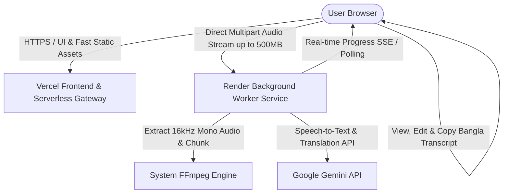

# Bangla Transcriber - Render + Vercel Deployment Guide

This guide provides beginner-friendly, step-by-step instructions to deploy **Bangla Transcriber** to the cloud:
- **Web Frontend**: Hosted on [Vercel](https://vercel.com) (Edge CDN, responsive UI, zero server maintenance).
- **Audio Processing Worker**: Hosted as a Docker Web Service on [Render](https://render.com) (System FFmpeg, chunking, Gemini speech-to-text, and translation).

---

## 1. System Architecture



### Why this architecture?
1. **Preserves 100% of the Desktop Features**: The browser UI includes the drag-and-drop zone, YouTube URL transcription, verbatim transcription, editable text area, honest progress reporting, and Bangla translation tabs.
2. **Bypasses Serverless Limits**: Vercel Serverless request handlers have short execution time limits (10s–60s) and a strict 4.5 MB body limit. By streaming audio directly to the Render worker, uploads up to 500 MB and long recordings run safely without timeouts.
3. **Secret Security**: `GEMINI_API_KEY` is kept securely on the Render worker and is **never** sent to the client browser or committed to GitHub.

---

## 2. Verified Directory Structure & Dockerfile Path

The repository is organized into distinct services:

```text
├── main.js                  # Original Electron main process (preserved)
├── preload.js               # Original Electron preload bridge (preserved)
├── package.json             # Root package.json (dev scripts and syntax checks)
├── src/                     # Original Electron renderer code (preserved)
│
├── web/                     # Vercel Web Application
│   ├── index.html           # Browser UI (HTML5 File API & YouTube input)
│   ├── style.css            # Responsive design tokens
│   ├── app.js               # Browser client logic (dynamic worker discovery & SSE)
│   ├── vercel.json          # Security headers & routing configuration
│   ├── package.json         # Web dependencies & build check scripts
│   └── api/                 # Serverless Gateway (status & proxy fallback)
│
└── worker/                  # Render Long-Running Worker Service
    ├── server.js            # Express server (CORS, 0.0.0.0 binding, uploads)
    ├── pipeline.js          # System FFmpeg chunking, YouTube stream, Gemini STT
    ├── jobs.js              # In-memory job manager with SSE & polling
    ├── package.json         # Worker dependencies (Google GenAI, Express, Multer)
    ├── Dockerfile           # Production container (Debian Bullseye + System FFmpeg)
    ├── .dockerignore        # Excludes node_modules and .env from Docker image
    └── .env.example         # Worker environment template
```

### Verified Docker Path for Render:
- **Worker Root Directory**: `worker`
- **Dockerfile Path**: `Dockerfile` (inside the `worker/` directory)
- **Docker Build Context**: `worker/`

When you set **Root Directory** to `worker` in Render, Render automatically locates `worker/Dockerfile` and uses `worker` as the build context.

---

## 3. Environment Variables Reference

### Render Worker Service (`worker` on Render)
| Variable | Required | Description |
| :--- | :--- | :--- |
| `GEMINI_API_KEY` | **Yes** | Your API key from [Google AI Studio](https://aistudio.google.com/). |
| `PORT` | Auto | Render automatically sets this (defaults to `4000` if not set). |
| `HOST` | Auto | Set to `0.0.0.0` in `worker/Dockerfile` so Render can route public traffic. |
| `FFMPEG_PATH` | Auto | Set to `/usr/bin/ffmpeg` in `worker/Dockerfile`. |

### Vercel Frontend Project (`web` on Vercel)
| Variable | Required | Description |
| :--- | :--- | :--- |
| `WORKER_URL` | **Yes** | The public HTTPS URL of your deployed Render worker (e.g., `https://bangla-transcriber-worker.onrender.com`). **Do not include a trailing slash.** |
| `GEMINI_API_KEY` | Optional | Optional fallback key if running direct translations via Vercel serverless functions. |

---

## 4. Beginner-Friendly Deployment Steps

Follow these steps in order. Deploy the worker first so you have its URL ready when setting up Vercel.

### Step 1: Push Your Code to GitHub
1. Open your terminal in the project root.
2. Ensure `.env` is NOT tracked (our `.gitignore` automatically ignores `.env`).
3. Commit and push your code to your GitHub repository:
   ```bash
   git add .
   git commit -m "Prepare Bangla Transcriber for Render and Vercel deployment"
   git push origin main
   ```

---

### Step 2: Deploy the Worker Service on Render
1. Sign in or create a free account at [Render.com](https://render.com).
2. From the Render Dashboard, click **New +** and select **Web Service**.
3. Choose **Build and deploy from a Git repository** and connect your GitHub repository.
4. Configure the service with the following settings:
   - **Name**: `bangla-transcriber-worker` (or your preferred name)
   - **Region**: Choose the region closest to you (e.g. *Frankfurt*, *Oregon*, or *Singapore*)
   - **Branch**: `main` (or your default branch)
   - **Root Directory**: `worker` *(Important: enter `worker` so Render builds from the worker folder)*
   - **Runtime**: `Docker` *(Render will automatically detect `worker/Dockerfile`)*
   - **Instance Type**: Select **Free**
5. Scroll down and expand **Advanced**:
   - **Health Check Path**: `/health`
6. Under the **Environment Variables** section, click **Add Environment Variable**:
   - **Key**: `GEMINI_API_KEY`
   - **Value**: Paste your Google Gemini API key (starts with `AIzaSy...`)
7. Click **Create Web Service**.
8. Render will pull the Debian Bullseye image, install system FFmpeg, install Node production dependencies, and start the service.
9. Watch the deploy logs until you see:
   ```text
   [Worker Service] Bangla Transcriber Worker listening on http://0.0.0.0:10000
   ==> Your service is live 🎉
   ```

---

### Step 3: Copy Your Render Public Service URL
1. At the top-left of your Render service dashboard (just below the service name), locate your assigned public HTTPS URL:
   - Example: `https://bangla-transcriber-worker.onrender.com`
2. Test the URL in a new browser tab by appending `/health`:
   - `https://bangla-transcriber-worker.onrender.com/health`
   - You should see a JSON response: `{"status":"ok","service":"bangla-transcriber-worker","isConfigured":true,...}`
3. Copy this URL without any trailing slash (`/`).

---

### Step 4: Deploy the Web Frontend on Vercel
1. Sign in or create an account at [Vercel.com](https://vercel.com).
2. From the Vercel Dashboard, click **Add New...** > **Project**.
3. Select your GitHub repository from the list and click **Import**.
4. In the **Configure Project** screen:
   - **Project Name**: `bangla-transcriber` (or your choice)
   - **Root Directory**: Click **Edit** next to Root Directory and select `web`, then click **Continue**.
   - **Framework Preset**: Select **Other** (Vanilla / Static).
5. Expand the **Environment Variables** section:
   - **Key**: `WORKER_URL`
   - **Value**: Paste your Render URL from Step 3 (e.g., `https://bangla-transcriber-worker.onrender.com`).
6. Click **Deploy**.
7. Vercel will deploy the site in a few seconds and assign a production URL (e.g. `https://bangla-transcriber.vercel.app`).

---

### Step 5: Verify Your Live Application
1. Open your live Vercel URL in your browser.
2. Look at the status pill in the top-right header:
   - It will display **"Backend & API Key Ready"** (or **"Worker Connected"**) with a steady green dot.
3. Test an upload:
   - Drag & drop an audio or video file (MP3, WAV, M4A, MP4, MOV) or enter a YouTube URL.
   - Watch the real-time progress bar update as Gemini transcribes.
   - Review the verbatim original transcript in the editor.
   - Click **Translate to Bangla** to test Bengali translation.
   - Click **Copy Transcript** to test clipboard copying.

---

## 5. Render Free-Tier Limitations & Suitability Analysis

The Render Free Tier is an excellent option for hosting this app for demonstration and testing. Here is how the app handles free-tier limits:

### 1. Inactivity Spin-Down (Sleeping Services)
- **Render Behavior**: Free web services automatically spin down (sleep) after **15 minutes of inactivity** to conserve resources.
- **Cold Start Time**: When a new request arrives after sleeping, Render spins the container back up. This cold start typically takes **50 to 90 seconds**.
- **How This App Handles It Gracefully**:
  - **Live Status Indicator**: When you visit the site while the worker is asleep, the pill initially shows `"Connecting to backend..."` or `"Backend unreachable"`.
  - **Automatic Wake-Up**: Loading the web page automatically sends a probe to `/api/status` and `/health`, triggering Render to wake up the worker immediately.
  - **Auto-Reconnect**: The frontend automatically checks backend status every 8 seconds when disconnected. As soon as the Render container finishes waking up, the status pill turns green automatically without needing to refresh the page.
  - **Manual Refresh**: Users can also click the status pill at any time to re-check connection status.

### 2. Ephemeral Filesystem (Stateless Processing)
- **Render Behavior**: The free tier uses an ephemeral filesystem. Any files stored on the container are wiped when the service spins down or restarts.
- **Why This App Is 100% Suitable**:
  - The worker is **completely stateless**. It does not use or require a persistent database on disk.
  - Uploaded audio files are written to temporary storage (`os.tmpdir()`) strictly for duration probing and chunking, and are **immediately deleted** in `finally` blocks upon completion.
  - Chunks created by FFmpeg are automatically unlinked once transcribed.
  - Files larger than 20 MB use the Google Gemini File API, which stores the file temporarily in Google's cloud and deletes it via `ai.files.delete` immediately after processing.
  - An automated cleanup routine sweeps `os.tmpdir()` every hour to delete any orphaned files older than 1 hour.

### 3. Memory & CPU Constraints
- **Render Behavior**: Free instances have **512 MB RAM** and **0.1 CPU core**.
- **Why This App Stays Well Within Limits**:
  - Audio extraction uses lightweight FFmpeg parameters (`-ar 16000 -ac 1 -b:a 32k`), keeping memory consumption around **40 MB to 70 MB** during processing.
  - Chunk concurrency is capped at `CONCURRENCY_LIMIT = 2` to prevent memory or CPU spikes.
  - Streaming uploads pipe directly to disk instead of buffering entire files in Node.js heap memory.

---

## 6. Pre-Deployment Local Validation

You can verify that all frontend and worker scripts pass syntax and build validation before deploying:

```bash
# Run syntax and integrity checks across web and worker:
npm run check

# Verify frontend production build:
npm run build:web
```

Both commands should complete with exit code `0`.

---

## 7. Troubleshooting Guide for Render + Vercel

| Symptom | Cause | Solution |
| :--- | :--- | :--- |
| **Status pill shows "Backend unreachable" for ~1 minute on first visit** | Render worker was asleep and is spinning up (cold start). | Wait 50–90 seconds. The frontend polls every 8s and will automatically turn green once the worker is awake. You can also click the status pill to re-check. |
| **Status pill says "API Key needed in environment"** | `GEMINI_API_KEY` is not set or still has the placeholder value in Render. | Open Render Dashboard > your Web Service > **Environment**. Verify that `GEMINI_API_KEY` is saved with your real key from Google AI Studio. |
| **Build fails on Render with "Dockerfile not found"** | Render's Root Directory was not set to `worker`. | In Render Web Service settings, verify that **Root Directory** is set to `worker`. Alternatively, set **Dockerfile Path** to `worker/Dockerfile`. |
| **Render error: "Port binding failed"** | Application attempted to bind to a fixed localhost address. | Verified fixed: `worker/server.js` listens on `process.env.PORT` and binds to `0.0.0.0` (set in code and Dockerfile). |
| **Vercel upload fails with HTTP 404** | `WORKER_URL` environment variable is missing in Vercel. | In Vercel Project Settings > **Environment Variables**, add `WORKER_URL` pointing to your Render HTTPS URL (`https://your-service.onrender.com`). Redeploy the project in Vercel to apply changes. |
| **Long audio transcription fails partway through** | Temporary chunk storage or timeout. | Verified fixed: The worker uses asynchronous jobs (HTTP 202) with SSE streaming and 1.2s polling fallback. Chunks are automatically retried up to 3 times across fallback Gemini models. |
